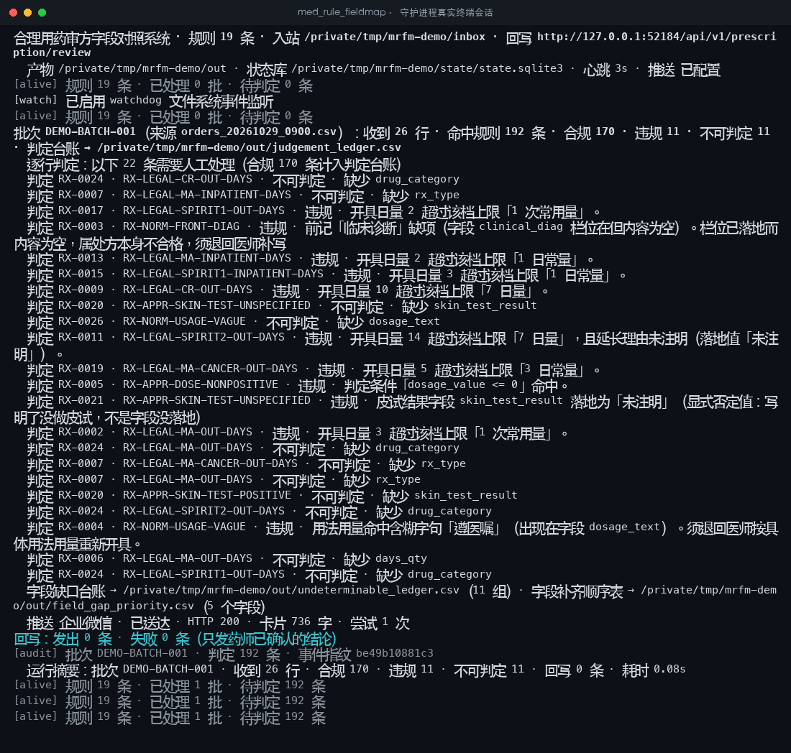
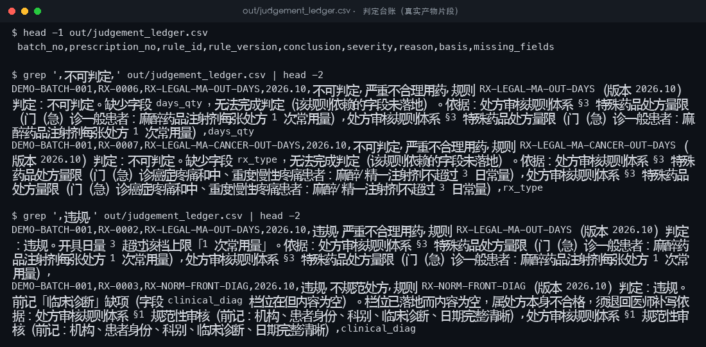
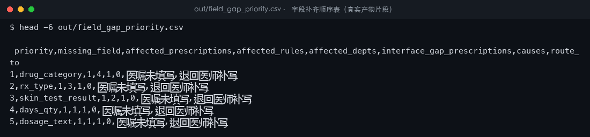

# 合理用药审方字段对照系统

> 药学部把审方规则配成规则行，HIS 一批医嘱落地到目录就自动算出「审得过 / 审不过 / 判不了」；判不了的点名缺哪个字段、卡在哪条规则，并汇成一张给信息科排接口补齐顺序的字段对照表。

本系统是药学部内网的**常驻服务**，不是跑一次出一张表的脚本。输入是 HIS 医嘱落地目录里的批次文件；输出是逐处方×逐规则的判定台账、一份专门列「判不了」的台账、一张按缺失字段排序的接口补齐顺序表、一份可导出的审计台账，以及一条推到企业微信的批次卡片。药师在台账上确认之后，系统才把结论回写 HIS 审方复核接口。判定链全部是**确定性求值**（规则行 → 受限表达式 → 三态结论）：同一批医嘱配同一版规则，算出来的结论与归因文本完全一致，可复算、可审计——这正是它能进药事审核流程的前提。

## 适用场景 / 目标岗位

| 岗位 | 什么时候用 | 得到什么 |
|---|---|---|
| 药事审核岗 | 规则改版或法规更新后，按月维护一次审方规则 | 一份带依据出处的规则行文件 + 一份规则体检结论：哪条规则从没生效过、哪条规则永远判不了 |
| 临床药师 | 每个医嘱批次落到落地目录后 | 每张处方的「合规 / 违规 / 判不了」结论；判不了时附带卡住的规则号与缺失字段名 |
| 信息科接口岗 | 收到「判不了」清单后，排下一轮接口改造 | 一张排好序的字段对照表：补哪个字段能救回多少张处方、解锁多少条规则、涉及多少个科室 |
| 医务 / 质控 | 月度抽查取样，或飞检前自证 | 可导出的判定台账与审计台账，每条结论都能追到规则号、规则版本与依据出处 |

## 能力要点

- **查不到的不当成没问题**：字段缺了判「不可判定」，不悄悄放过也不误判成违规，归因里点名缺哪个字段、卡在哪条规则。
- **缺口按字段聚合成一张可施工的表**：直接回答「先补哪个字段最划算」——补一个字段救回多少张处方、解锁多少条规则，一目了然，接口改造排期不再靠拍脑袋。
- **规则由药事审核岗自己配**：阈值不写死在代码里，每条规则是一个带依据出处的配置文件，改版只改配置；没有依据出处的规则不会被载入生效。
- **医嘱一到就处理，不用人记得跑**：常驻进程盯着落地目录，文件落地即判定、落盘、推送，不需要谁记得去点按钮或排定时任务。
- **没经药师确认的结论绝不回写**：回写 HIS 前必须走人工确认，确认可撤回；同一批次重复投递不会重复判定、不会重复回写。
- **每条结论都能追到源头、重启不重复干活**：批次 → 规则号 → 规则版本 → 依据出处 → 事件文件指纹 → 当前状态全链路可导出；守护进程被 kill 或断电后重启接着上次没做完的批次走，一个状态库只允许一个实例在跑。

## 快速开始
### 依赖

Python ≥ 3.11（开发与验证环境使用 3.11.15）。依赖见 `requirements.txt`：`httpx`（出站回写与推送）、`PyYAML`（规则行）、`watchdog`（目录监听，可选增强，缺失时退化为 1 秒轮询）、`pytest`（测试）。
### 安装

```bash
cd medication-rule-fieldmap
python3.11 -m venv .venv
source .venv/bin/activate
pip install -r requirements.txt
```
### 配置

复制 `.env.example` 为 `.env` 并按院内实际填写；**所有凭据一律从环境变量读取**，程序不硬编码、不从配置文件读密钥。

| 配置项 | 默认值 | 说明 |
|---|---|---|
| `HIS_BASE_URL` | （空） | HIS 审方复核接口基址；未配置时守护进程显式失败并退出，不静默跳过 |
| `HIS_API_TOKEN` | （空） | 回写用 Bearer 令牌；缺失时拒绝发出请求并告警 |
| `WECOM_WEBHOOK_URL` | （空） | 企业微信群机器人 webhook；缺失时推送告警，不阻断判定与回写 |
| `MRFM_INBOX_DIR` | `./inbox` | HIS 医嘱落地目录（**只读**） |
| `MRFM_OUT_DIR` | `./out` | 台账与导出产物目录 |
| `MRFM_STATE_DB` | `./state/mrfm.sqlite3` | 批次与判定状态库（SQLite，WAL 模式） |
| `MRFM_RULES_DIR` | `./rules` | 规则行目录；守护进程按文件 mtime 热重载 |
| `MRFM_HEARTBEAT_SEC` | `30` | 心跳行打印间隔（秒） |
### 构建与验证

```bash
# 单元测试（全量回归）
pytest tests/ -q
# 规则行载入校验：非法规则行返回非 0 退出码并打印字段名与行列定位
python -m med_rule_fieldmap.cli rules validate --rules rules/sample
# 端到端跑一批判定，产出可核对的判定台账与不可判定台账
python -m med_rule_fieldmap.cli judge --inbox tests/data/batch --rules rules/sample --out out
# 带状态库跑一遍：同时落审计台账（判定事件行数 == 判定行数）
python -m med_rule_fieldmap.cli judge --inbox tests/data/batch --rules rules/sample \
    --out out --state-db state/mrfm.sqlite3
# 一条龙验证：自建虚拟环境装依赖 → 起守护进程跑完样例批次 → 断言三份台账
# 与回写请求（方法 / 路径 / Authorization / JSON 字段）。退出码 0 即通过。
bash scripts/verify_install_use_verify.sh
```
### 主命令速查

```bash
# 起守护进程：监听落地目录，医嘱一到即判定、落盘、推送
python -m med_rule_fieldmap.daemon --inbox inbox --rules rules/sample --out out
# 跑一批判定（运维通道，不常驻）
python -m med_rule_fieldmap.cli judge --inbox inbox --rules rules/sample --out out
# 校验规则行：有非法规则时退出码非 0，并打印字段名与行列定位
python -m med_rule_fieldmap.cli rules validate --rules rules/sample
# 导出判定台账 / 不可判定台账 / 字段补齐顺序表
python -m med_rule_fieldmap.cli ledger export --db state/mrfm.sqlite3 --inbox inbox --out out
# 看守护状态与运行摘要（JSON，便于脚本消费）
python -m med_rule_fieldmap.cli status --db state/mrfm.sqlite3 --json
# 药师确认一条结论（回写的硬门禁；--key 取判定幂等键或业务键）
python -m med_rule_fieldmap.cli confirm --db state/mrfm.sqlite3 --key <判定幂等键> --by <药师标识>
# 出站链路预检：只核对凭据与地址，不发任何请求；缺凭据退出码 2
python -m med_rule_fieldmap.outbound --check
```
### 部署到药学部内网

单机部署，两条路任选其一；**凭据一律放在仓外**（systemd 用 `EnvironmentFile`、compose 用 `env_file`），仓库内不含任何真实密钥。落地目录以**只读**方式挂进容器（`:ro`）——本产品不改 HIS 落地文件。

```bash
# 路线 A：systemd（推荐）——程序放 /opt/medication-rule-fieldmap，
# 凭据放 /etc/medication-rule-fieldmap/med-rule-fieldmap.env（权限 0600）
sudo systemctl daemon-reload && sudo systemctl enable --now med-rule-fieldmap
sudo journalctl -u med-rule-fieldmap -f        # 看心跳与批次摘要
# 路线 B：docker compose（凭据走 deploy/.env，落地目录 :ro 挂载）
cp .env.example deploy/.env
docker compose -f deploy/docker-compose.yml up -d
docker compose -f deploy/docker-compose.yml logs -f med-rule-fieldmap
```

部署单元见 `deploy/systemd/med-rule-fieldmap.service`、`deploy/docker-compose.yml`、`deploy/Dockerfile`。

## 命令 / API / 配置说明
### 关键配置项

出站对接的三条通道，凭据位全部指向环境变量，程序内无硬编码地址与密钥：

| 对接项 | 形态 | 方向 | 凭据位 |
|---|---|---|---|
| HIS 审方复核 | `POST {HIS_BASE_URL}/api/v1/prescription/review` | 写 | 请求头 `Authorization: Bearer $HIS_API_TOKEN` |
| 企业微信推送 | `POST $WECOM_WEBHOOK_URL`，body `msgtype=markdown` | 写 | 无独立凭据（群机器人 URL 自带） |
| HIS 医嘱落地目录 | `$MRFM_INBOX_DIR` 下的批次文件（CSV / HL7 v2 `ORM^O01`） | 读 | 无（只读目录，不改落地文件） |
### CLI 子命令 / 接口端点

| 命令 | 用途 | 关键参数 |
|---|---|---|
| `python -m med_rule_fieldmap.daemon` | 常驻守护：监听落地目录，事件到达即判定、落盘、推送、回写 | `--inbox` `--rules` `--out` `--state-db` `--heartbeat-sec` |
| `... cli judge` | 跑一批判定并写出台账（运维通道，不常驻）；带 `--state-db` 时一并落审计台账 | `--inbox` `--rules` `--out` `--state-db` `--json` |
| `... cli scan` | 扫描落地目录：写完的文件切批次，写坏的文件整文件挂起 | `--inbox` `--out` `--wait-sec` `--release` |
| `... cli rules validate` | 校验规则行；非法规则**退出码非 0**并定位到字段名与行列，其余规则照常生效 | `--rules` `--as-of` `--json` |
| `... cli rules health` | 规则集体检：僵尸规则、恒判不了的规则、覆盖率（分母是适用处方数） | `--rules` `--db` `--inbox` `--out` `--json` |
| `... cli ledger export` | 导出判定台账；给了 `--inbox` 连不可判定台账与字段补齐顺序表一起导 | `--db` `--out` `--batch` `--conclusion` `--inbox` `--json` |
| `... cli audit export` | 导出审计台账（飞检与内审自证）；缺依据出处时显式报错且**不落盘** | `--db` `--out` `--batch` `--json` |
| `... cli batch replay` | 按批次号回放判定证据链，可按规则号与结论类型过滤 | `--db` `--batch` `--out` `--rules` `--rule` `--conclusion` `--json` |
| `... cli writeback` | 查看 / 重放 HIS 抖动时待重放的回写（幂等键保证不重复回写） | `--db` `--replay` `--limit` `--json` |
| `... cli confirm` / `... cli revoke` | 药师确认 / 撤回 / 触发回写（回写 HIS 的硬门禁：只有已确认的结论才回写） | `--db` `--key` `--by` `--note` `--withdraw` `--trigger` `--list` `--resync` `--json` |
| `... cli state` / `... cli status` | 查状态库与守护运行摘要（批次 / 三态计数 / 待复核 / 回写数 / 耗时） | `--db` `--batch` `--json` |

> `rules validate` / `rules health` / `ledger export` / `audit export` / `batch replay` 是两层子命令（先动作域再动作），`rules` 另有 `rule` 简写别名。`ledger export` 与 `audit export` 的 `--db` 必填——台账与审计的权威源是状态库，不是落地文件。
>
> **完整参数、退出码与边界行为见 [`docs/cli.md`](docs/cli.md)**（本文只留最常用的十几条；退出码统一为 `0` 成功 / `2` 显式失败 / `3` 守护进程已在运行）。
### 错误与降级

| 场景 | 表现 | 处理方式 |
|---|---|---|
| 落地文件被截断 / 乱码 / 必需列缺失 | 该文件不产生任何判定行 | 整文件挂起，记入挂起台账并告警，**绝不做部分判定**（半截判定比不判定更危险） |
| `HIS_BASE_URL` 未配置 | 守护进程起不来 | 显式失败并退出，不静默跳过 |
| `HIS_API_TOKEN` 缺失 | 回写请求不发出 | 拒绝发出并告警，结论仍留在台账等确认 |
| HIS 回写返回的处方号与请求不一致 | 跨系统实体绑定有歧义 | 进挂起队列并告警，**不落库** |
| HIS 回写连续失败 / 撤回同步不到 HIS | 重试到上限仍失败，或本地已撤回而 HIS 端复核记录仍在 | 指数退避重试至 3 次，超次落 `pending_writeback` 并告警；撤回同步失败记「撤回待同步」并告警，绝不假装两边一致（可用 `cli confirm --resync` 重投） |
| 企业微信推送失败 / webhook 未配置 | 批次结论照常落盘 | 只记告警，不阻断判定与回写主流程；告警文本隐去 webhook 地址里的凭据位 |
| 规则文件写法错误 | 该条规则不生效 | 载入期拒绝并定位到字段名与行列，其余规则照常生效；`cli rules validate` 有非法规则时**退出码非 0** |
| 同一批次被重投 | 不产生重复判定 | 只补审计行；回写请求数不变（幂等键抑制） |
| 审计台账缺依据出处 | 不落盘 | 显式报错并指出是哪几行；不导出一份看着正常、实则漏了依据的表 |
| 守护进程起第二个实例 / 被 kill 后重启 | 第二个实例拒绝启动（退出码 `3`）；重启后接着走上次没做完的批次 | 打印占用进程的 pid / 主机 / 启动时间；续跑时判定幂等键挡住重复判定、卡片不重推、回写不重发；源文件不在了或被改过则保留断点并告警 |
### 对接现有系统

- **入站（读）**：HIS 医嘱落地目录 `$MRFM_INBOX_DIR`，**只读不改**。CSV 与 HL7 v2 `ORM^O01` 解析出等价字段；CSV 按表头名映射列、不依赖列序，UTF-8 优先、GBK 兜底解码；数值列容忍单位后缀（如 `3日量` 取 3）。**入站字段共 28 列**，其中 `rx_type` / `drug_category` / `days_qty` / `extend_reason` / `skin_test_result` 属常缺列：缺列不挂起文件，而是落「不可判定」并点名该字段。字段全表见 [`docs/data-sources.md`](docs/data-sources.md)。
- **出站（写）·HIS 审方复核**：`POST {HIS_BASE_URL}/api/v1/prescription/review`，请求头 `Authorization: Bearer $HIS_API_TOKEN`、`Content-Type: application/json`，请求体字段严格 11 个：`batch_no` `prescription_no` `rule_id` `rule_version` `conclusion` `severity` `reason` `basis` `missing_fields` `reviewed_by` `reviewed_at`（`conclusion` 取 `compliant` / `violation` / `undeterminable` 三个英文值；事件文件指纹只留在本地审计，不进请求体）。
- **出站（写）·撤回通知**：`POST {HIS_BASE_URL}/api/v1/prescription/review/withdraw`，字段严格 10 个：`batch_no` `prescription_no` `rule_id` `rule_version` `conclusion` `basis` `reviewed_by` `withdrawn_by` `withdrawn_at` `reason`。还没发出去的结论被撤回时**不发任何请求**（排队中的回写直接作废）；已经发出去的才走这个接口，同步失败记「撤回待同步」并告警。
- **出站（写）·企业微信推送**：`POST $WECOM_WEBHOOK_URL`，请求体固定 `{"msgtype":"markdown","markdown":{"content":"…"}}`，正文三段——批次摘要、不可判定条目摘要（点名缺失字段与卡住的规则号）、字段补齐顺序摘要。正文超长时**截断并注明**完整清单在哪两份台账里，不做「悄悄少发几条」。webhook 地址里的 `key` 属凭据位，**告警与日志一律隐去**。
- **凭据来源与预检**：全部读环境变量，`.env.example` 只有空占位。部署当天先跑 `python -m med_rule_fieldmap.outbound --check`（只核对回写链路的凭据位与地址、**不发任何请求**，缺凭据退出码 `2`）与 `--check-push`（单独核对推送 webhook）。**干跑与替身只出现在测试数据层**，正式对接方式以本文与 `docs/data-sources.md` 的字段规范为准。

## 典型场景
### 场景 1：药事审核岗按月配一次规则

1. 在 `rules/` 下按模板增改规则行，每条必须写依据出处；没有依据出处的规则不会被载入生效。
2. 起守护进程前先跑一次规则校验；月底看规则体检结论：哪条规则从没命中过（多半写错了）、哪条规则永远判不了（多半它依赖的字段根本拿不到）。

```bash
# 1) 校验规则行：非法行返回非 0，并打印字段名与行列定位
python -m med_rule_fieldmap.cli rules validate --rules rules/sample
# 2) 月度体检：僵尸规则 / 恒判不了的规则 / 覆盖率
python -m med_rule_fieldmap.cli rules health --rules rules/sample \
    --db state/mrfm.sqlite3 --inbox inbox --out out
```
### 场景 2：临床药师逐批复核一批医嘱

1. 守护进程守着落地目录，批次文件一落地就自动判定并落盘，同时把批次摘要推到企业微信。
2. 药师在判定台账上逐条看：合规的扫一眼，违规的看归因，判不了的先知道缺什么。
3. 药师确认后，系统才把结论回写 HIS 审方复核接口；撤回顾师的确认则不再回写。

```bash
# 批次判定（守护进程自动触发；运维通道也可单跑一批）
python -m med_rule_fieldmap.cli judge --inbox inbox --rules rules/sample --out out --state-db state/mrfm.sqlite3
# 药师确认一条结论（确认是回写的硬门禁；--key 取判定幂等键或业务键）
python -m med_rule_fieldmap.cli confirm --db state/mrfm.sqlite3 --key <判定幂等键> --by <药师标识>
```
### 场景 3：信息科接口岗按字段排改造顺序

1. 收到「判不了」清单后，先看按缺失字段聚合的表：每个字段影响多少张处方、多少条规则、多少个科室。
2. 按补齐优先级从上往下排，先补影响面最大的那个字段；字段补齐后重投该批次，之前判不了的会自动重判，历史结论保留不丢。

```bash
# 导出字段补齐顺序表（给了 --inbox 才导得出来——成因要靠落地文件才判得出）
python -m med_rule_fieldmap.cli ledger export --db state/mrfm.sqlite3 --inbox inbox --out out
# 重放某个批次的判定证据链：追到规则号、规则版本、依据出处、事件文件指纹
python -m med_rule_fieldmap.cli batch replay --db state/mrfm.sqlite3 --batch <批次号> --out out --json
```

## 输出样例

以下为**脱敏**样例片段（真实运行产物落在 `$MRFM_OUT_DIR`）。完整可复现样例、真实终端回显、挂起台账、守护进程会话与规模化回归报告见 [`docs/examples.md`](docs/examples.md)。
### 判定台账 `out/judgement_ledger.csv`

逐处方 × 逐规则一行，结论三态，附归因文本与依据出处。

```csv
batch_no,prescription_no,rule_id,rule_version,conclusion,severity,reason,basis,missing_fields
<批次号>,RX-0021,RX-APPR-SKIN-TEST-UNSPECIFIED,2026.10,违规,不合理用药,规则 RX-APPR-SKIN-TEST-UNSPECIFIED（版本 2026.10）判定：违规。皮试结果字段 skin_test_result 落地为「未注明」（显式否定值：写明了没做皮试，不是字段没落地）依据：处方审核规则体系 §1 适宜性审核第 1 项（规定必须做皮试的药品，是否注明过敏试验及结果判定）,处方审核规则体系 §1 适宜性审核第 1 项（规定必须做皮试的药品，是否注明过敏试验及结果判定）,
<批次号>,RX-0007,RX-LEGAL-MA-OUT-DAYS,2026.10,不可判定,严重不合理用药,规则 RX-LEGAL-MA-OUT-DAYS（版本 2026.10）判定：不可判定。缺少字段 rx_type，无法完成判定（该规则依赖的字段未落地）。依据：处方审核规则体系 §3 特殊药品处方量限（门（急）诊一般患者：麻醉药品注射剂每张处方 1 次常用量）,处方审核规则体系 §3 特殊药品处方量限（门（急）诊一般患者：麻醉药品注射剂每张处方 1 次常用量）,rx_type
```
### 不可判定台账 `out/undeterminable_ledger.csv`

只收「判不了」的条目，按**缺失字段 × 规则**聚合。`cause` 一列说清缺口的成因，两种成因处置方不同：**接口未回传**（整列没落地）要信息科改接口；**医嘱未填写**（栏位在但没填）退回医师补写——不分开就会把医师漏填排到信息科的改造清单上。

```csv
missing_field,rule_id,cause,affected_prescriptions,affected_depts
days_qty,RX-LEGAL-MA-OUT-DAYS,医嘱未填写,1,1
dosage_text,RX-NORM-USAGE-VAGUE,医嘱未填写,1,1
```
### 字段补齐顺序表 `out/field_gap_priority.csv`

按「受影响处方数降序 → 受影响规则数降序 → 字段名升序」稳定排序，同输入同输出。`route_to` 直接给出承接方，`interface_gap_prescriptions` 是其中「接口未回传」的处方数——这张表就是给信息科排改造顺序用的。

```csv
priority,missing_field,affected_prescriptions,affected_rules,affected_depts,interface_gap_prescriptions,causes,route_to
1,drug_category,1,4,1,0,医嘱未填写,退回医师补写
2,rx_type,1,3,1,0,医嘱未填写,退回医师补写
```

## 概念 / 实测对照
### 视觉目标

结构化视觉目标卡见 [`docs/concepts/visual-target.md`](docs/concepts/visual-target.md)。画面类型为**服务运行日志（终端会话）**，与本产品「事件驱动守护」的交付形态一致——**不是**浏览器面板、**不是**一次性表格导出页、**不是**桌面窗口。

三个状态：**起始态**是 banner 行 + 等间隔心跳行；**首个可用瞬间**是批次摘要行 + 缩进一格的逐行判定 + 台账落盘路径行 + 推送回执行；**成形态**是常驻心跳、每批次稳定产出可下载台账、判不了的按缺失字段聚合成接口补齐顺序表推给信息科、确认后回写并打印回执行、出站失败退避超次打红字告警。配色（终端 ANSI）：背景 `#0F1115`、正文 `#D5D9E0`、判定完成 `#3FB950`、不可判定 `#D29922`、回写成功 `#39C5CF`、告警 `#F85149`、审计与心跳 `#8B949E`；等宽字体，信息层级为「批次摘要（最显眼）→ 逐行判定（次级）→ 回执与审计（最暗灰）」。当前运行环境不具备图像生成能力，因此 `docs/concepts/` **只落这张结构化视觉目标卡**，不生成、不伪造任何概念图。
### 实测证据

下面三张是**真实运行截图**（不是设计稿）：`scripts/capture_screenshots.py` 在真实伪终端里起守护进程，把真 TTY 下的日志与真实落盘的产物渲染成 PNG。







采集口径：守护进程在真实伪终端中启动，`tests/data/batch/` 的脱敏样例批次投进落地目录；HIS 审方复核回写与企业微信推送走**本地真实 HTTP 服务**（真实 socket + 真实 HTTP 报文，地址在 `127.0.0.1`）——它只是**地址替身**，属于测试数据层，**不是最终对接方式**。截图里的路径、耗时、批次号与计数均由真实运行决定；终端原文另存 `docs/screenshots/daemon-session.txt`，可逐行复核。

> **诚实标注**：上为视觉目标（`docs/concepts/visual-target.md` 的结构化视觉目标卡），下为真实实测。常驻进程**没有图形界面**，所有「看板」类元素一律以日志行与导出文件体现——目标卡里的批次计数、目录路径、规则条数是示意值，实测截图里的真实值与之不同；实测画面**只逐行列出违规与不可判定两类**（合规明细在判定台账里，不在画面上刷屏）。**不声称两者完全一致**，也没有生成任何「事后效果图」来抹平差距。

## 架构与数据流

```
 入站：HIS 医嘱落地目录 (read-only)        配置：规则行 rules/*.yaml
 ├─ batch_*.csv (28 列, 表头映射)            │ rule_id/layer/basis/
 ├─ batch_*.hl7 (HL7 v2 ORM^O01)             │ expression/severity/limit_ref
 └─ 截断/乱码/缺列 → 整文件挂起                │
          ▼                                   ▼
 ┌────────────────────────┐       ┌────────────────────────┐
 │ ingest 目录监听         │       │ rules 规则行仓库        │
 │ 批次切分 / 完整性校验    │       │ 载入校验 / 生效区间      │
 │ 事件文件 sha256 指纹    │       │ mtime 热重载            │
 └───────────┬────────────┘       └───────────┬────────────┘
             ▼                               ▼
 ┌───────────────────────────────────────────────────────────────┐
 │ engine 三态判定内核：受限表达式求值（AST, 解析树 LRU 512）+ 归一层 │
 │ 规则调度 → required_fields 缺失 → 不可判定 → 归因文本            │
 └───────────────┬───────────────────────────────┬───────────────┘
                 ▼                               ▼
 ┌───────────────────────────┐   ┌──────────────────────────────┐
 │ ledger 台账与聚合          │   │ store 状态库 (SQLite/WAL)    │
 │ judgement_ledger.csv     │   │ 判定行 / 批次 / 幂等键        │
 │ undeterminable_ledger    │   │ 状态机：待判定→已判定→药师已确认│
 │ field_gap_priority.csv   │   │       →已回写；缺字段→重判     │
 │ rule_health / audit      │   │       已撤回 / 已挂起          │
 └───────────┬───────────────┘   └──────────────┬───────────────┘
             ▼                                  ▼
 ┌───────────────────────────┐   ┌──────────────────────────────┐
 │ outbound 企业微信推送      │   │ outbound HIS 审方复核回写      │
 │ 批次摘要 + 不可判定摘要    │   │ POST /api/v1/prescription/    │
 │ 失败只告警，不阻断主流程    │   │      review (Bearer)         │
 └───────────────────────────┘   │ 仅「药师已确认」可触发         │
                                  │ 幂等抑制 / 退避 / 挂起队列    │
                                  └──────────────────────────────┘
```
### 关键不变量

- **幂等键**：判定业务键 `sha256(batch_no｜prescription_no｜rule_id｜rule_version)`；同一批次重复投递只补审计，不新增判定行，回写请求数不变。
- **状态跃迁校验**：判定行状态机显式枚举合法跃迁，非法跃迁（如「已判定」直接跳「已回写」）被拒绝并记入告警。
- **失败不静默改数据**：出站失败退避重试 ≤ 3 次，超次落 `pending_writeback` 并告警；回写响应处方号与请求不一致时判为实体绑定歧义，进挂起队列**不落库**。
- **未确认不回写**：只有「药师已确认」状态的结论才可能出现在回写请求体里；确认可撤回。
- **不完整输入不部分判定**：文件截断 / 乱码 / 必需列缺失 → 整文件挂起，宁可不出结论，不出半截结论。
- **一个状态库只有一个守护进程**：第二个实例拿不到锁就退出（退出码 `3`）并报出占用进程的 pid / 主机 / 启动时间，不会两台守护对着同一个 HIS 各回写一遍。
- **重启后接着走，不重复干活**：批次进度落库（只前进不后退）；续跑时判定幂等键挡住重复判定、已推送的判定行数挡住重复推卡片、回写幂等键挡住重复发请求；源文件不在了或被改过就保留断点等人工重投。

> **模块分层、状态机、幂等键体系、审计链与失败降级矩阵见 [`docs/architecture.md`](docs/architecture.md)**；
> **哪份数据是正式对接规范、哪份只是测试数据层，见 [`docs/data-sources.md`](docs/data-sources.md)**。

## 安全与合规边界

- 只做**规则级判定**，不出诊断结论、不给治疗建议、不评价用药方案的临床合理性；诊断相符性与相互作用配伍的实质判定不在本系统范围。
- 规则行必须带**依据出处**才允许生效；无依据的规则一律拒绝载入，不允许「凭印象写规则」。
- 患者侧只落**脱敏 `patient_ref`**，归因文本与台账不出现姓名、身份证号等可识别明细。
- **不代签处方、不自动签章**：后记签章只判缺项，不判签名真伪；任何结论进入 HIS 前必须经药师人工确认。

## 验收与自检

| 验收项 | 命令 | 期望结果 |
|---|---|---|
| 一条龙安装 → 使用 → 验证 | `bash scripts/verify_install_use_verify.sh` | 退出码 `0`：自建虚拟环境装依赖 → 守护进程跑完样例批次 → 三份台账产物行数 > 0 → 回写请求的方法 / 路径 / `Authorization` / JSON 字段全集断言通过 |
| 规则行载入校验 | `python -m med_rule_fieldmap.cli rules validate --rules rules/sample` | 合法规则集通过；含非法规则时退出码非 0 并打印字段名与行列定位 |
| 端到端判定 | `python -m med_rule_fieldmap.cli judge --inbox tests/data/batch --rules rules/sample --out out` | 生成 `out/judgement_ledger.csv`，行数 = 处方数 × 命中规则数 |
| 三态分流 | `pytest tests/test_judge.py -q` | 缺 `rx_type` 的处方结论为「不可判定」且 `missing_fields` 点名该字段 |
| 空值 ≠ 显式否 | `pytest tests/test_skin_test.py -q` | 「未注明」判违规、空字符串判不可判定 |
| 字段缺口聚合与排序稳定 | `pytest tests/test_gap_ledger.py tests/test_priority.py -q` | 按缺失字段正确分组、各组处方数正确；同输入两次运行排序完全一致 |
| 官方案例回归 | `pytest tests/test_baseline_cases.py -q` | 10 条官方案例逐条结论与依据一致 |
| 规模化回归 | `pytest tests/test_scale_regression.py -q` | 2000 行跑通；缓存命中率 ≥ 90%；吞吐 ≥ 200 行/秒；两次跑三态分布逐项一致 |
| 三态 vs 二元基线 | `pytest tests/test_baseline_compare.py -q` | 不可判定召回率三态 100% / 二元 0%；两份 JSON 报告落盘且可复现 |
| 回写请求规范 | `pytest tests/test_his_review.py -q` | 请求方法、路径、`Authorization` 头与 JSON 字段全集断言通过 |
| 未确认零回写 | `pytest tests/test_confirm.py -q` | 未确认项不出现在任何回写请求体 |
| 重启续跑 / 单实例锁 | `pytest tests/test_daemon_resume.py -q` | 判定行零重复、卡片不重推、回写不重发；源文件缺失 / 改过则保留断点并告警；第二个实例被拒（退出码 `3`）且错误信息点名占用进程 |
| 出站链路预检 | `python -m med_rule_fieldmap.outbound --check` | 缺 `HIS_BASE_URL` / `HIS_API_TOKEN` 时退出码 `2` 并点名缺哪一项；**不发任何请求** |
| 全量回归 | `pytest tests/ -q` | 全部通过 |

## 项目结构

```text
medication-rule-fieldmap/            # 产品根目录
├── src/med_rule_fieldmap/            # 产品代码（Python 包）
│   ├── config.py                     # 环境变量与默认值、凭据位校验
│   ├── logging_setup.py              # 结构化日志：批次摘要 / 逐行判定 / 审计与心跳三层视觉层级
│   ├── models.py                     # 处方行 / 规则行 / 判定行 / 审计行 数据模型
│   ├── store.py                      # 批次表、判定表、幂等键、审计表、出站调用表、批次进度与运行摘要（SQLite/WAL）
│   ├── daemon.py                     # 常驻守护：监听 → 批次 → 判定 → 落盘 → 推送 → 回写；断点续跑
│   ├── daemon_lock.py                # 状态库单实例文件锁（一个状态库只允许一个守护进程在跑）
│   ├── cli.py                        # 运维 CLI：judge / scan / state / status / rules / ledger / audit / batch / confirm / writeback
│   ├── ingest/                       # 入站：CSV 解析、HL7 ORM^O01 解析、完整性校验、目录监听、文件指纹、整文件挂起
│   ├── expression/                   # 受限表达式：lexer / parser / AST / validator / evaluator / cache / normalize
│   ├── rules/                        # 规则行 schema 校验与规则仓库（生效区间 + 热重载）
│   ├── engine/                       # 判定内核：调度、量限、皮试、规范性、重复给药、超常处方、状态机、严重度、归因
│   ├── ledger/                       # 台账：判定台账、字段缺口聚合、补齐优先级、规则体检、证据链回放、审计台账导出
│   └── outbound/                     # 出站：HIS 审方复核、企业微信推送、幂等、退避重试队列、审计留痕
├── rules/sample/                     # 19 条可跑示例规则行（合法性 / 规范性 / 适宜性三层，均带依据出处）
├── tests/data/                       # 脱敏样例医嘱与回归用例（CSV / HL7）
├── scripts/                          # 数据准备脚本：确定性种子合成规模集 + 公开数据集下载（断网降级）+ 规模化回归与基线对比 + 采集真实运行截图 + 一条龙验证脚本（安装 → 使用 → 验证）
├── docs/                             # 文档分层：cli.md 全量命令 / examples.md 输出样例 / architecture.md 架构与状态机 / data-sources.md 数据来源边界 / concepts 视觉目标卡 / screenshots 真实运行截图 / reports 回归报告副本
├── deploy/                           # 院内部署：Dockerfile + docker-compose.yml + systemd/med-rule-fieldmap.service（内网单机）
├── .env.example                      # 环境变量样例（无真实密钥）
├── requirements.txt                  # 依赖清单（产品运行时；requirements-docs.txt 为截图采集脚本的 Pillow 依赖）
├── qrcode.jpg                        # 关注区块配图
├── LICENSE                           # MIT 许可证与随仓数据的许可边界说明
└── README.md                         # 本文件：产品说明
```

## License

MIT（完整文本见 [`LICENSE`](LICENSE)；随仓数据的许可边界同文件内中文说明）

---

## 关注我们

欢迎扫码关注公众号，获取项目更新与交流加群：

