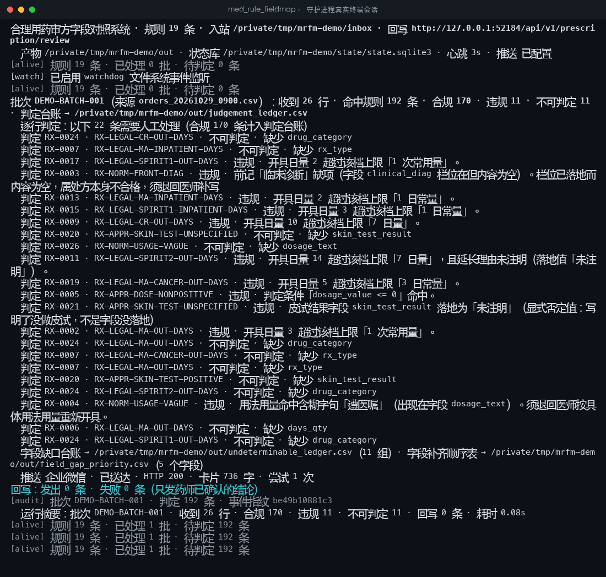
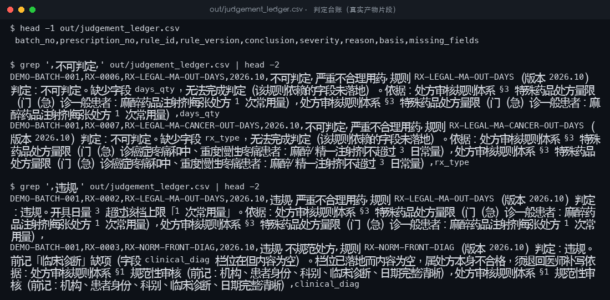
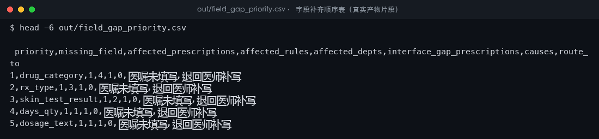

# Medication Review Field-Mapping System (合理用药审方字段对照系统)

> The pharmacy department turns review rules into rule rows; once a batch of HIS orders lands in the drop directory, the system computes **compliant / violation / undeterminable** for each one — and for every *undeterminable* case it names the missing field and the blocked rule, then aggregates everything into a field-mapping table that tells the IT department which interface to fix first.

This system is a **resident service** on the pharmacy department's intranet — not a script that runs once and prints a table. Input is the batch files produced in the HIS order drop directory. Output is a per-prescription × per-rule judgement ledger, a dedicated ledger of the *undeterminable* cases, a field-gap priority table ordered by missing field, an exportable audit ledger, and a batch card pushed to WeCom. Only after a pharmacist confirms an entry on the ledger does the system write the conclusion back to the HIS review interface. The entire decision chain is **deterministic evaluation** (rule row → restricted expression → three-state conclusion): the same orders under the same rule version always yield byte-identical conclusions and attribution text, so results are recomputable and auditable — which is exactly what makes the output admissible in a pharmacy affairs review process.

## Use Cases / Target Roles

| Role | When it is used | What they get |
|---|---|---|
| Pharmacy affairs reviewer | Maintains the review rules once a month after a rule revision or regulatory update | A rule-row file with a basis-of-authority citation, plus a rule health report: which rules have never fired, and which rules can never be judged |
| Clinical pharmacist | After each order batch lands in the drop directory | A compliant / violation / undeterminable verdict per prescription; for undeterminable cases, the blocked rule ID and the missing field name |
| IT interface engineer | After receiving the "undeterminable" list, to schedule the next round of interface work | A field-mapping table already sorted by priority: how many prescriptions each field rescues, how many rules it unlocks, how many departments it touches |
| Medical affairs / quality control | Monthly sampling audits, or self-evidence before an on-site inspection | Exportable judgement and audit ledgers where every conclusion traces back to its rule ID, rule version, and basis of authority |

## Key Capabilities

- **A missing field is never treated as "no problem"**: the verdict is *undeterminable* — neither silently passed nor misjudged as a violation — and the attribution text names the missing field and the rule it blocked.
- **Gaps are aggregated by field into an actionable table**: it answers "which field should we fix first" directly — how many prescriptions one field rescues, how many rules it unlocks — so interface work is scheduled on evidence instead of guesswork.
- **Rules are configured by the pharmacy affairs team, not hardcoded**: thresholds live in a configuration file, every rule row carries its basis of authority, a revision only touches configuration, and a rule without a basis of authority is never loaded into effect.
- **Orders are processed on arrival — nobody has to remember to run it**: the resident process watches the drop directory and judges, persists, and pushes the moment a file lands, with no button to click and no cron job to schedule.
- **Nothing is written back without pharmacist confirmation**: the HIS write-back is gated on human confirmation, confirmation can be withdrawn, and a redelivered batch never re-judges and never writes back twice.
- **Every conclusion traces to its source, and restarts never redo work**: batch → rule ID → rule version → basis of authority → event file fingerprint → current status is fully traceable and exportable; after the daemon is killed or the host loses power it resumes the unfinished batch, and only one instance may run against a state database.

## Quick Start

### Dependencies

Python ≥ 3.11 (development and verification used 3.11.15). Dependencies are listed in `requirements.txt`: `httpx` (outbound write-back and push), `PyYAML` (rule rows), `watchdog` (directory watching, optional enhancement — it degrades to 1-second polling when absent), `pytest` (tests).

### Installation

```bash
cd medication-rule-fieldmap
python3.11 -m venv .venv
source .venv/bin/activate
pip install -r requirements.txt
```

### Configuration

Copy `.env.example` to `.env` and fill in the real in-house values; **all credentials are read from environment variables** — the program hardcodes nothing and never reads secrets from a config file.

| Setting | Default | Description |
|---|---|---|
| `HIS_BASE_URL` | (empty) | Base URL of the HIS review interface; when unset the daemon fails explicitly and exits rather than skipping silently |
| `HIS_API_TOKEN` | (empty) | Bearer token for the write-back; when missing the request is refused and an alert is raised |
| `WECOM_WEBHOOK_URL` | (empty) | WeCom group robot webhook; when missing the push only raises an alert and does not block judgement or write-back |
| `MRFM_INBOX_DIR` | `./inbox` | HIS order drop directory (**read-only**) |
| `MRFM_OUT_DIR` | `./out` | Directory for ledgers and exported artifacts |
| `MRFM_STATE_DB` | `./state/mrfm.sqlite3` | Batch and judgement state database (SQLite, WAL mode) |
| `MRFM_RULES_DIR` | `./rules` | Rule-row directory; the daemon hot-reloads on file mtime changes |
| `MRFM_HEARTBEAT_SEC` | `30` | Heartbeat line print interval (seconds) |

### Build & Verify

```bash
# Unit tests (full regression)
pytest tests/ -q
# Rule-row load validation: invalid rule rows exit non-zero and print the field name plus line/column location
python -m med_rule_fieldmap.cli rules validate --rules rules/sample
# End-to-end judgement of one batch, producing a checkable judgement ledger and an undeterminable ledger
python -m med_rule_fieldmap.cli judge --inbox tests/data/batch --rules rules/sample --out out
# Same run with a state database, which also persists the audit ledger (audit event rows == judgement rows)
python -m med_rule_fieldmap.cli judge --inbox tests/data/batch --rules rules/sample \
    --out out --state-db state/mrfm.sqlite3
# One-shot verification: create a venv and install dependencies → run the daemon over the sample batch → assert the three ledgers
# and the write-back request (method / path / Authorization / JSON fields). Exit code 0 means pass.
bash scripts/verify_install_use_verify.sh
```

### Main Command Reference

```bash
# Start the daemon: watch the drop directory, judge / persist / push the moment orders arrive
python -m med_rule_fieldmap.daemon --inbox inbox --rules rules/sample --out out
# Judge one batch (operations channel, non-resident)
python -m med_rule_fieldmap.cli judge --inbox inbox --rules rules/sample --out out
# Validate rule rows: non-zero exit on invalid rules, printing field name and line/column location
python -m med_rule_fieldmap.cli rules validate --rules rules/sample
# Export the judgement ledger / undeterminable ledger / field-gap priority table
python -m med_rule_fieldmap.cli ledger export --db state/mrfm.sqlite3 --inbox inbox --out out
# Inspect daemon state and run summary (JSON, for script consumption)
python -m med_rule_fieldmap.cli status --db state/mrfm.sqlite3 --json
# A pharmacist confirms one conclusion (the hard gate for write-back; --key takes the judgement idempotency key or business key)
python -m med_rule_fieldmap.cli confirm --db state/mrfm.sqlite3 --key <judgement-idempotency-key> --by <pharmacist-id>
# Outbound pre-flight: verifies credentials and addresses only, sends no request; exit code 2 when credentials are missing
python -m med_rule_fieldmap.outbound --check
```

### Deploying to the Pharmacy Department Intranet

Single-host deployment; pick either route; **credentials always live outside the repository** (systemd uses `EnvironmentFile`, compose uses `env_file`), and no real secret is committed. The drop directory is mounted **read-only** (`:ro`) — this product never modifies HIS drop files.

```bash
# Route A: systemd (recommended) — program at /opt/medication-rule-fieldmap,
# credentials at /etc/medication-rule-fieldmap/med-rule-fieldmap.env (mode 0600)
sudo systemctl daemon-reload && sudo systemctl enable --now med-rule-fieldmap
sudo journalctl -u med-rule-fieldmap -f        # watch heartbeat lines and batch summaries
# Route B: docker compose (credentials via deploy/.env, drop directory mounted :ro)
cp .env.example deploy/.env
docker compose -f deploy/docker-compose.yml up -d
docker compose -f deploy/docker-compose.yml logs -f med-rule-fieldmap
```

Deployment units: `deploy/systemd/med-rule-fieldmap.service`, `deploy/docker-compose.yml`, `deploy/Dockerfile`.

## Commands / API / Configuration

### Key Configuration Items

Three outbound channels, all credential slots pointing at environment variables — no hardcoded address or secret anywhere in the code:

| Integration | Shape | Direction | Credential slot |
|---|---|---|---|
| HIS prescription review | `POST {HIS_BASE_URL}/api/v1/prescription/review` | write | Header `Authorization: Bearer $HIS_API_TOKEN` |
| WeCom push | `POST $WECOM_WEBHOOK_URL`, body `msgtype=markdown` | write | No separate credential (the group robot URL carries it) |
| HIS order drop directory | Batch files under `$MRFM_INBOX_DIR` (CSV / HL7 v2 `ORM^O01`) | read | None (read-only directory; drop files are never modified) |

### CLI Subcommands / API Endpoints

| Command | Purpose | Key parameters |
|---|---|---|
| `python -m med_rule_fieldmap.daemon` | Resident daemon: watch the drop directory, and on each event judge, persist, push, and write back | `--inbox` `--rules` `--out` `--state-db` `--heartbeat-sec` |
| `... cli judge` | Judge one batch and write the ledgers (operations channel, non-resident); with `--state-db` it also persists the audit ledger | `--inbox` `--rules` `--out` `--state-db` `--json` |
| `... cli scan` | Scan the drop directory: fully written files are split into batches, malformed files are quarantined whole | `--inbox` `--out` `--wait-sec` `--release` |
| `... cli rules validate` | Validate rule rows; invalid rules **exit non-zero** and are located to a field name and line/column, while the remaining rules stay in effect | `--rules` `--as-of` `--json` |
| `... cli rules health` | Rule-set health check: zombie rules, rules that can never be judged, coverage (denominator = applicable prescriptions) | `--rules` `--db` `--inbox` `--out` `--json` |
| `... cli ledger export` | Export the judgement ledger; when `--inbox` is given, the undeterminable ledger and field-gap priority table are exported as well | `--db` `--out` `--batch` `--conclusion` `--inbox` `--json` |
| `... cli audit export` | Export the audit ledger (self-evidence for on-site inspections and internal audits); a missing basis of authority is an explicit error and **nothing is written** | `--db` `--out` `--batch` `--json` |
| `... cli batch replay` | Replay the evidence chain of a batch by batch number, filterable by rule ID and conclusion type | `--db` `--batch` `--out` `--rules` `--rule` `--conclusion` `--json` |
| `... cli writeback` | Inspect or replay write-backs pending after an HIS hiccup (the idempotency key prevents duplicate write-backs) | `--db` `--replay` `--limit` `--json` |
| `... cli confirm` / `... cli revoke` | Pharmacist confirm / withdraw / trigger write-back (hard gate for HIS write-back: only confirmed conclusions are written back) | `--db` `--key` `--by` `--note` `--withdraw` `--trigger` `--list` `--resync` `--json` |
| `... cli state` / `... cli status` | Query the state database and the daemon run summary (batches / three-state counts / pending review / write-back count / elapsed time) | `--db` `--batch` `--json` |

> `rules validate` / `rules health` / `ledger export` / `audit export` / `batch replay` are two-level subcommands (action domain first, then action), and `rules` additionally has a `rule` shorthand alias. `--db` is mandatory for `ledger export` and `audit export` — the authoritative source for ledgers and audits is the state database, not the drop files.
>
> **Full parameters, exit codes, and boundary behaviour: [`docs/cli.md`](docs/cli.md)** (this README keeps only the dozen most common ones; exit codes are uniformly `0` success / `2` explicit failure / `3` daemon already running).

### Errors & Degradation

| Scenario | Behaviour | Handling |
|---|---|---|
| Drop file truncated / garbled / missing required column | That file produces no judgement rows at all | The whole file is quarantined, recorded in the quarantine ledger, and an alert is raised — **never a partial judgement** (half a judgement is more dangerous than none) |
| `HIS_BASE_URL` not configured | The daemon cannot start | Explicit failure and exit, no silent skip |
| `HIS_API_TOKEN` missing | No write-back request is sent | The request is refused and an alert raised; the conclusion still stays on the ledger awaiting confirmation |
| The prescription number returned by HIS does not match the request | Cross-system entity binding is ambiguous | The case enters the quarantine queue with an alert and is **not persisted** |
| Repeated HIS write-back failures / a withdrawal that never reaches HIS | Failures persist past the retry limit, or the local side is withdrawn while the HIS review record still exists | Exponential backoff retries up to 3 times; past that it lands in `pending_writeback` with an alert. A failed withdrawal sync is recorded as "withdrawal pending sync" with an alert — it never pretends the two sides agree (re-deliver with `cli confirm --resync`) |
| WeCom push fails / webhook not configured | Batch conclusions are still persisted | Only an alert is recorded; the judgement and write-back flow is not blocked, and the alert text masks the credential portion of the webhook URL |
| A rule file is malformed | That rule does not take effect | Rejected at load time and located to a field name and line/column; the other rules stay in effect. `cli rules validate` exits **non-zero** when invalid rules exist |
| The same batch is redelivered | No duplicate judgements are produced | Only audit rows are added; the number of write-back requests is unchanged (suppressed by the idempotency key) |
| The audit ledger lacks a basis of authority | Nothing is written | An explicit error points at the offending rows; the system never exports a table that looks complete but has dropped the basis |
| A second daemon instance starts / restart after a kill | The second instance refuses to start (exit code `3`); after restart it resumes the unfinished batch | It prints the occupying process's PID / host / start time; on resume the judgement idempotency key blocks duplicate judgements, cards are not re-pushed, and write-backs are not re-sent; if the source file is gone or was modified, the checkpoint is kept and an alert is raised |

### Integration with Existing Systems

- **Inbound (read)**: the HIS order drop directory `$MRFM_INBOX_DIR`, **read-only, never modified**. CSV and HL7 v2 `ORM^O01` are parsed into equivalent fields; CSV columns are mapped by header name rather than column order, UTF-8 is preferred with a GBK fallback, and numeric columns tolerate unit suffixes (e.g. `3日量` yields 3). **There are 28 inbound columns**, of which `rx_type` / `drug_category` / `days_qty` / `extend_reason` / `skin_test_result` are frequently absent: a missing column does not quarantine the file — it produces an *undeterminable* verdict naming that field. The full field table is in [`docs/data-sources.md`](docs/data-sources.md).
- **Outbound (write) · HIS prescription review**: `POST {HIS_BASE_URL}/api/v1/prescription/review`, header `Authorization: Bearer $HIS_API_TOKEN`, `Content-Type: application/json`. The request body has exactly 11 fields: `batch_no` `prescription_no` `rule_id` `rule_version` `conclusion` `severity` `reason` `basis` `missing_fields` `reviewed_by` `reviewed_at` (`conclusion` takes one of the three English values `compliant` / `violation` / `undeterminable`; the event file fingerprint stays in the local audit trail and never enters the request body).
- **Outbound (write) · withdrawal notice**: `POST {HIS_BASE_URL}/api/v1/prescription/review/withdraw`, exactly 10 fields: `batch_no` `prescription_no` `rule_id` `rule_version` `conclusion` `basis` `reviewed_by` `withdrawn_by` `withdrawn_at` `reason`. When a conclusion that has not yet been sent is withdrawn, **no request is sent at all** (a queued write-back is simply voided); only already-sent conclusions go through this endpoint, and a failed sync is recorded as "withdrawal pending sync" with an alert.
- **Outbound (write) · WeCom push**: `POST $WECOM_WEBHOOK_URL`, request body fixed as `{"msgtype":"markdown","markdown":{"content":"…"}}`, with three sections in the content — batch summary, undeterminable-item summary (naming the missing fields and the blocked rule IDs), and field-gap priority summary. When the body is too long it is **truncated with a note** saying where the full lists live, rather than silently dropping a few entries. The `key` portion of the webhook URL is a credential and is **always masked** in alerts and logs.
- **Credential sources and pre-flight**: everything is read from environment variables, and `.env.example` contains only empty placeholders. On deployment day, first run `python -m med_rule_fieldmap.outbound --check` (verifies the write-back chain's credential slots and addresses only, **sends no request**, exit code `2` when credentials are missing) and `--check-push` (verifies the push webhook separately). **Dry runs and stand-ins appear only in the test data layer**; the authoritative integration contract is this README together with the field specification in `docs/data-sources.md`.

## Typical Scenarios

### Scenario 1: The pharmacy affairs reviewer maintains the rules once a month

1. Add or edit rule rows under `rules/` following the template; each one must state its basis of authority, and a rule without one is never loaded into effect.
2. Run a rule validation before starting the daemon; at month end review the rule health report: which rule never matched (usually a typo) and which rule can never be judged (usually its required field is simply not available).

```bash
# 1) Validate rule rows: invalid rows exit non-zero and print the field name plus line/column location
python -m med_rule_fieldmap.cli rules validate --rules rules/sample
# 2) Monthly health check: zombie rules / rules that can never be judged / coverage
python -m med_rule_fieldmap.cli rules health --rules rules/sample \
    --db state/mrfm.sqlite3 --inbox inbox --out out
```

### Scenario 2: A clinical pharmacist reviews an order batch prescription by prescription

1. The daemon watches the drop directory; the moment a batch file lands it is judged and persisted automatically, and a batch summary is pushed to WeCom.
2. The pharmacist works through the judgement ledger: compliant entries get a glance, violations get their attribution read, and undeterminable ones first tell them what is missing.
3. Only after the pharmacist confirms does the system write the conclusion back to the HIS review interface; withdrawing the pharmacist's confirmation stops the write-back.

```bash
# Batch judgement (triggered automatically by the daemon; the operations channel can also run a single batch)
python -m med_rule_fieldmap.cli judge --inbox inbox --rules rules/sample --out out --state-db state/mrfm.sqlite3
# A pharmacist confirms one conclusion (confirmation is the hard gate for write-back; --key takes the judgement idempotency key or business key)
python -m med_rule_fieldmap.cli confirm --db state/mrfm.sqlite3 --key <judgement-idempotency-key> --by <pharmacist-id>
```

### Scenario 3: The IT interface engineer schedules field fixes by priority

1. After receiving the "undeterminable" list, start with the table aggregated by missing field: how many prescriptions, rules, and departments each field affects.
2. Work down the gap priority, fixing the widest-impact field first; once the field is delivered, redeliver that batch — previously undeterminable cases are re-judged automatically and historical conclusions are preserved.
3. Replay the evidence chain of any batch to trace a conclusion back to its rule ID, rule version, basis of authority, and event file fingerprint.

```bash
# Export the field-gap priority table (only exported when --inbox is given — the cause can only be derived from the drop files)
python -m med_rule_fieldmap.cli ledger export --db state/mrfm.sqlite3 --inbox inbox --out out
# Replay a batch's judgement evidence chain: trace back to rule ID, rule version, basis of authority, event file fingerprint
python -m med_rule_fieldmap.cli batch replay --db state/mrfm.sqlite3 --batch <batch-no> --out out --json
```

## Output Samples

The following are **de-identified** sample excerpts (real run artifacts land in `$MRFM_OUT_DIR`). Complete reproducible samples, real terminal transcripts, the quarantine ledger, a daemon session, and the scale regression report are in [`docs/examples.md`](docs/examples.md).

*The CSV rows below are shown verbatim as the system emits them: ledger conclusion values are the Chinese labels `违规` (violation) and `不可判定` (undeterminable), `cause` values are `医嘱未填写` (order field left blank by the clinician) and `接口未回传` (interface did not return the column), and `route_to` values name the responsible party. The HIS write-back body, by contrast, uses the English `conclusion` values `compliant` / `violation` / `undeterminable`.*

### Judgement ledger `out/judgement_ledger.csv`

One row per prescription × rule, with a three-state conclusion, the attribution text, and the basis of authority.

```csv
batch_no,prescription_no,rule_id,rule_version,conclusion,severity,reason,basis,missing_fields
<批次号>,RX-0021,RX-APPR-SKIN-TEST-UNSPECIFIED,2026.10,违规,不合理用药,规则 RX-APPR-SKIN-TEST-UNSPECIFIED（版本 2026.10）判定：违规。皮试结果字段 skin_test_result 落地为「未注明」（显式否定值：写明了没做皮试，不是字段没落地）依据：处方审核规则体系 §1 适宜性审核第 1 项（规定必须做皮试的药品，是否注明过敏试验及结果判定）,处方审核规则体系 §1 适宜性审核第 1 项（规定必须做皮试的药品，是否注明过敏试验及结果判定）,
<批次号>,RX-0007,RX-LEGAL-MA-OUT-DAYS,2026.10,不可判定,严重不合理用药,规则 RX-LEGAL-MA-OUT-DAYS（版本 2026.10）判定：不可判定。缺少字段 rx_type，无法完成判定（该规则依赖的字段未落地）。依据：处方审核规则体系 §3 特殊药品处方量限（门（急）诊一般患者：麻醉药品注射剂每张处方 1 次常用量）,处方审核规则体系 §3 特殊药品处方量限（门（急）诊一般患者：麻醉药品注射剂每张处方 1 次常用量）,rx_type
```

### Undeterminable ledger `out/undeterminable_ledger.csv`

Collects only the *undeterminable* entries, aggregated by **missing field × rule**. The `cause` column states why the gap exists, and the two causes have different owners: **interface did not return it** (the whole column is absent) is the IT department's interface work; **order field left blank** (the slot exists but is empty) goes back to the clinician to fill in. Conflating them would push clinicians' omissions onto the IT department's backlog.

```csv
missing_field,rule_id,cause,affected_prescriptions,affected_depts
days_qty,RX-LEGAL-MA-OUT-DAYS,医嘱未填写,1,1
dosage_text,RX-NORM-USAGE-VAGUE,医嘱未填写,1,1
```

### Field-gap priority table `out/field_gap_priority.csv`

Stably sorted by **affected prescriptions descending → affected rules descending → field name ascending**, so the same input always produces the same output. `route_to` names the owning party directly, and `interface_gap_prescriptions` counts the prescriptions in the "interface did not return it" bucket — this table is exactly what the IT department uses to schedule interface work.

```csv
priority,missing_field,affected_prescriptions,affected_rules,affected_depts,interface_gap_prescriptions,causes,route_to
1,drug_category,1,4,1,0,医嘱未填写,退回医师补写
2,rx_type,1,3,1,0,医嘱未填写,退回医师补写
```

## Concept vs. Actual Screenshots

### Visual Target

The structured visual target card is in [`docs/concepts/visual-target.md`](docs/concepts/visual-target.md). The picture type is a **service run log (terminal session)**, matching this product's event-driven daemon delivery form — it is **not** a browser panel, **not** a one-shot table export page, and **not** a desktop window.

The three states: the **start state** is a banner line plus evenly spaced heartbeat lines; the **first usable moment** is a batch summary line, indented per-line verdicts, a ledger persistence path line, and the push receipt; the **mature state** is a steady heartbeat, a downloadable ledger per batch, undeterminable cases aggregated by missing field into a field-gap priority table pushed to the IT department, write-back receipts printed after confirmation, and red-text alerts when outbound backoff exceeds its limit. Colours (terminal ANSI): background `#0F1115`, body text `#D5D9E0`, judgement complete `#3FB950`, undeterminable `#D29922`, write-back success `#39C5CF`, alert `#F85149`, audit and heartbeat `#8B949E`; monospace type, with the information hierarchy "batch summary (most prominent) → per-line verdicts (secondary) → receipts and audit (dim grey)". The current environment has no image-generation capability, so `docs/concepts/` contains **only** this structured visual target card — no concept images are generated or faked.

### Real Run Evidence

The three images below are **real run screenshots** (not design mockups): `scripts/capture_screenshots.py` starts the daemon inside a real pseudo-terminal and renders the genuine TTY log output and the genuinely persisted artifacts into PNGs.







Capture method: the daemon is started inside a real pseudo-terminal and the de-identified sample batch from `tests/data/batch/` is dropped into the drop directory; the HIS prescription-review write-back and the WeCom push go through a **local real HTTP service** (real socket, real HTTP wire format, address on `127.0.0.1`) — it is only an **address stand-in** belonging to the test data layer, **not** the final integration method. The paths, elapsed times, batch numbers, and counts in the screenshots are all determined by the real run; the raw terminal transcript is stored separately as `docs/screenshots/daemon-session.txt` for line-by-line review.

> **Honest note**: the visual target (the structured visual target card in `docs/concepts/visual-target.md`) is on the left, the real measured run is on the right. The resident process **has no graphical interface** — every "dashboard"-style element appears as log lines and exported files. The batch counts, directory paths, and rule counts in the target card are illustrative, and the real values in the screenshots differ; the real screen **lists only the violation and undeterminable categories line by line** (compliant details live in the judgement ledger rather than flooding the screen). **No claim is made that the two are fully identical**, and no "after-the-fact mockup" was generated to paper over the difference.

## Architecture & Data Flow

```
Inbound: HIS order drop directory (read-only)  Config: rule rows rules/*.yaml
├─ batch_*.csv (28 cols, header mapping)       │ rule_id / layer / basis
├─ batch_*.hl7 (HL7 v2 ORM^O01)                │ expression / severity / limit_ref
└─ truncated / garbled / missing column        │
       → quarantined as a whole file           │
                ▼                                             ▼
 ┌──────────────────────────────┐                                                             ┌──────────────────────────────┐
 │ ingest: directory watch      │                                                             │ rules: rule-row store        │
 │ batch splitting / integrity  │                                                             │ load validation / window     │
 │ event file sha256 fingerprint│                                                             │ mtime hot-reload             │
 └──────────────┬───────────────┘                                                             └──────────────┬───────────────┘
┌──────────────────────────────────────────────────────────────────────────────┐
│ engine three-state kernel: restricted expression evaluation                  │
│ (AST, parse-tree LRU 512) + normalization layer                              │
│ rule dispatch → required_fields missing → undeterminable → attribution text  │
└───────────┬──────────────────────────────────────────┬───────────────────────┘
            ▼                                          ▼
 ┌──────────────────────────────┐                                               ┌──────────────────────────────┐
 │ ledger: ledgers & aggregation│                                               │ store: state db (SQLite/WAL) │
 │ judgement_ledger.csv         │                                               │ judgement rows / batches /   │
 │ undeterminable_ledger.csv    │                                               │ idempotency keys             │
 │ field_gap_priority.csv       │                                               │ state machine: pending →     │
 │ rule_health / audit          │                                               │ → confirmed → written back   │
 │ export + evidence replay     │                                               │ withdrawn / quarantined      │
 └──────────┬───────────────────┘                                               └──────────────┬───────────────┘
            ▼                                          ▼
 ┌──────────────────────────────┐                                               ┌──────────────────────────────┐
 │ outbound WeCom push          │                                               │ outbound HIS review          │
 │ batch summary +              │                                               │ POST /api/v1/                │
 │ undeterminable summary       │                                               │   prescription/review        │
 │ field-gap priority summary   │                                               │ only pharmacist-confirmed    │
 │ failures only alert,         │                                               │ may trigger; idempotency /   │
 │ never block the flow         │                                               │ backoff / quarantine queue   │
 └──────────────────────────────┘                                               └──────────────────────────────┘
```

### Key Invariants

- **Idempotency key**: the judgement business key is `sha256(batch_no｜prescription_no｜rule_id｜rule_version)`; a redelivered batch only adds audit rows, creates no new judgement rows, and leaves the write-back request count unchanged.
- **State transition validation**: the judgement row state machine enumerates legal transitions explicitly; an illegal transition (e.g. "judged" jumping straight to "written back") is rejected and recorded as an alert.
- **Failures never silently mutate data**: outbound failures back off and retry ≤ 3 times, then land in `pending_writeback` with an alert; when the write-back response's prescription number differs from the request, it is treated as an entity-binding ambiguity and enters the quarantine queue **without being persisted**.
- **No write-back without confirmation**: only a conclusion in the "pharmacist-confirmed" state may appear in a write-back request body, and the confirmation can be withdrawn.
- **Incomplete input never yields a partial judgement**: a truncated / garbled file or a missing required column quarantines the whole file — better no conclusion than half a conclusion.
- **One daemon per state database**: a second instance that cannot take the lock exits (exit code `3`) and reports the occupying process's PID / host / start time, so two daemons never write back to the same HIS separately.
- **Resume after restart without redoing work**: batch progress is persisted and only moves forward; on resume the judgement idempotency key blocks duplicate judgements, the pushed-row count blocks duplicate card pushes, and the write-back idempotency key blocks duplicate requests; if the source file is gone or has been modified, the checkpoint is kept pending manual redelivery.

> **Module layering, state machine, idempotency key system, audit chain, and the failure degradation matrix: [`docs/architecture.md`](docs/architecture.md)**;
> **Which data set is the formal integration contract and which is only the test data layer: [`docs/data-sources.md`](docs/data-sources.md)**.

## Security & Compliance Boundaries

- Rule-level judgement **only** — it produces no diagnostic conclusions, no treatment advice, and does not judge the clinical appropriateness of a medication plan; substantive determination of diagnostic concordance and interaction compatibility is out of scope.
- A rule row must carry a **basis of authority** before it may take effect; rules without one are refused at load time, so nobody can "write a rule from impression".
- On the patient side only a **de-identified `patient_ref`** is stored; attribution text and ledgers never contain names, national ID numbers, or other identifiable detail.
- **No signing on behalf of a prescriber and no automatic stamping**: the post-signature checks only detect missing items, never the authenticity of a signature; every conclusion must be confirmed by a human pharmacist before entering the HIS.

## Acceptance & Self-Check

| Acceptance item | Command | Expected result |
|---|---|---|
| One-shot install → use → verify | `bash scripts/verify_install_use_verify.sh` | Exit code `0`: create a venv and install dependencies → the daemon completes the sample batch → the three ledger artifacts each have > 0 rows → assertions on the write-back request's method / path / `Authorization` / full JSON field set pass |
| Rule-row load validation | `python -m med_rule_fieldmap.cli rules validate --rules rules/sample` | A legal rule set passes; with an invalid rule it exits non-zero and prints the field name plus line/column location |
| End-to-end judgement | `python -m med_rule_fieldmap.cli judge --inbox tests/data/batch --rules rules/sample --out out` | Produces `out/judgement_ledger.csv` with row count = prescriptions × matched rules |
| Three-state routing | `pytest tests/test_judge.py -q` | A prescription missing `rx_type` yields "undeterminable" and `missing_fields` names that field |
| Empty value ≠ explicit negative | `pytest tests/test_skin_test.py -q` | "未注明" (not stated) is judged a violation, an empty string is judged undeterminable |
| Field-gap aggregation and stable ordering | `pytest tests/test_gap_ledger.py tests/test_priority.py -q` | Entries are grouped correctly by missing field with correct per-group prescription counts; two runs on the same input produce identical ordering |
| Official case regression | `pytest tests/test_baseline_cases.py -q` | 10 official cases each match on conclusion and basis |
| Scale regression | `pytest tests/test_scale_regression.py -q` | 2000 rows complete; cache hit rate ≥ 90%; throughput ≥ 200 rows/second; the three-state distribution is identical item by item across two runs |
| Three-state vs. binary baseline | `pytest tests/test_baseline_compare.py -q` | Undeterminable recall is 100% for the three-state model and 0% for the binary model; both JSON reports are written and reproducible |
| Write-back request contract | `pytest tests/test_his_review.py -q` | Assertions on the request method, path, `Authorization` header, and the full JSON field set pass |
| Zero write-back without confirmation | `pytest tests/test_confirm.py -q` | Unconfirmed entries never appear in any write-back request body |
| Restart resume / single-instance lock | `pytest tests/test_daemon_resume.py -q` | Zero duplicate judgement rows, no duplicate card push, no duplicate write-back; a missing or modified source file keeps the checkpoint and raises an alert; a second instance is refused (exit code `3`) with the occupying process named in the error |
| Outbound pre-flight | `python -m med_rule_fieldmap.outbound --check` | Exit code `2` when `HIS_BASE_URL` / `HIS_API_TOKEN` are missing, naming which one is absent; **no request is sent** |
| Full regression | `pytest tests/ -q` | All tests pass |

## Project Structure

```text
medication-rule-fieldmap/            # Product root
├── src/med_rule_fieldmap/            # Product code (Python package)
│   ├── config.py                     # Environment variables, defaults, credential-slot validation
│   ├── logging_setup.py              # Structured logging: batch summary / per-line verdict / audit & heartbeat visual hierarchy
│   ├── models.py                     # Data models: prescription row / rule row / judgement row / audit row
│   ├── store.py                      # Batch table, judgement table, idempotency keys, audit table, outbound call table, batch progress and run summary (SQLite/WAL)
│   ├── daemon.py                     # Resident daemon: watch → batch → judge → persist → push → write back; checkpoint resume
│   ├── daemon_lock.py                # Single-instance file lock for the state database (only one daemon per state database)
│   ├── cli.py                        # Operations CLI: judge / scan / state / status / rules / ledger / audit / batch / confirm / writeback
│   ├── ingest/                       # Inbound: CSV parsing, HL7 ORM^O01 parsing, integrity checks, directory watching, file fingerprinting, whole-file quarantine
│   ├── expression/                   # Restricted expressions: lexer / parser / AST / validator / evaluator / cache / normalize
│   ├── rules/                        # Rule-row schema validation and rule store (effectivity window + hot reload)
│   ├── engine/                       # Judgement kernel: dispatch, quantity limits, skin test, normativity, duplicate dosing, abnormal prescriptions, state machine, severity, attribution
│   ├── ledger/                       # Ledgers: judgement ledger, field-gap aggregation, gap priority, rule health, evidence-chain replay, audit ledger export
│   └── outbound/                     # Outbound: HIS prescription review, WeCom push, idempotency, backoff retry queue, audit trail
├── rules/sample/                     # 19 runnable sample rule rows (legality / normativity / appropriateness layers, all with a basis of authority)
├── tests/data/                       # De-identified sample orders and regression cases (CSV / HL7)
├── scripts/                          # Data preparation: deterministic seeded scale set + public dataset download (offline degradation) + scale regression and baseline comparison + real screenshot capture + one-shot verification script (install → use → verify)
├── docs/                             # Layered docs: cli.md full command reference / examples.md output samples / architecture.md architecture and state machine / data-sources.md data source boundaries / concepts visual target card / screenshots real run screenshots / reports regression report copies
├── deploy/                           # In-house deployment: Dockerfile + docker-compose.yml + systemd/med-rule-fieldmap.service (single-host intranet)
├── .env.example                      # Environment variable samples (no real secrets)
├── requirements.txt                  # Dependency list (product runtime; requirements-docs.txt holds the Pillow dependency for the screenshot capture script)
├── qrcode.jpg                        # Image for the follow-us block
├── LICENSE                           # MIT license and the licensing boundary note for bundled data
└── README.md                         # This document: product documentation
```

## License

MIT (full text in [`LICENSE`](LICENSE); the licensing boundary for bundled data is stated in the same file)

---

## Follow Us

Scan the QR code to follow our official account for updates and community access:

